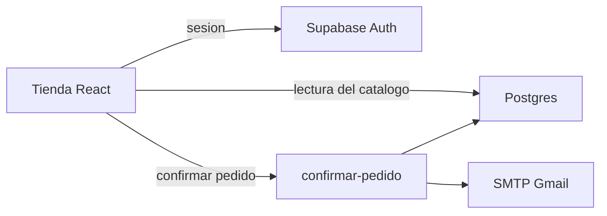
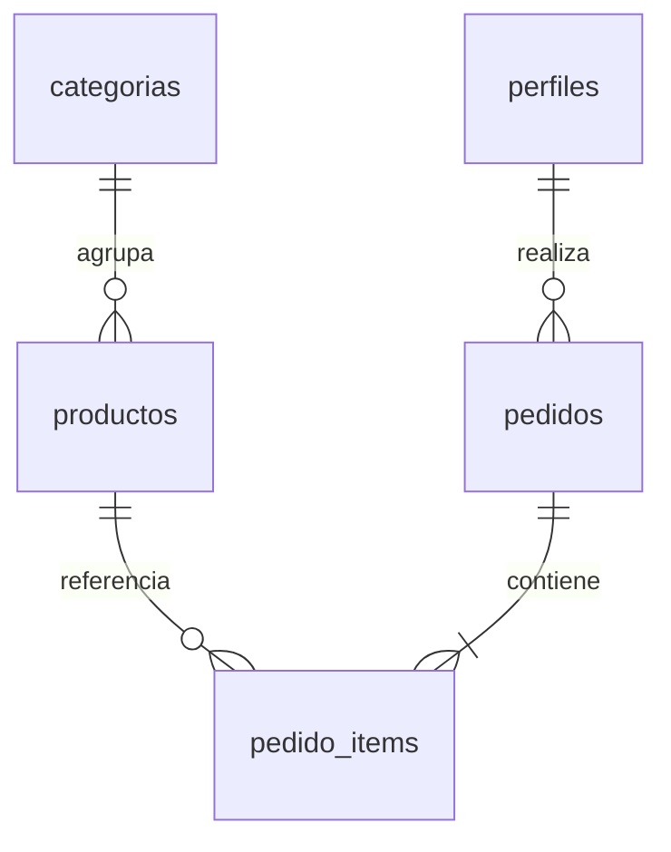
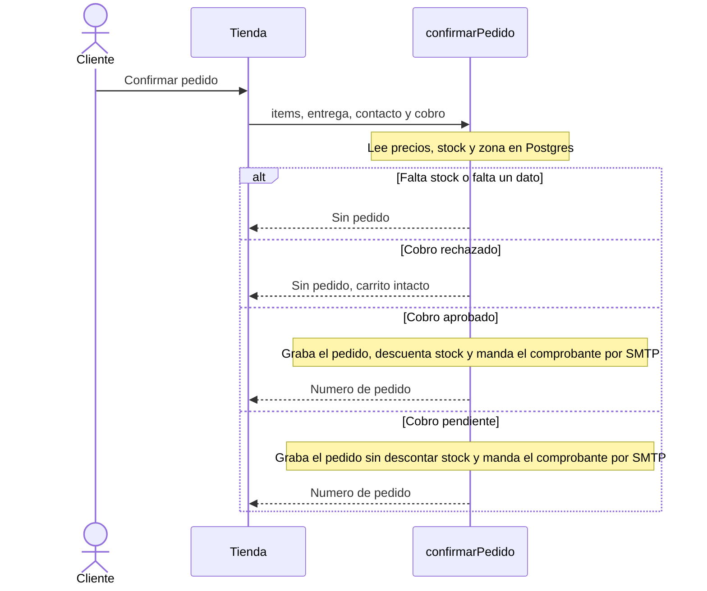

# Diseño - Tienda web 'Dietética Los Mirasoles'

Documento de referencia de la fase de diseño. Se apoya en los requerimientos iniciales y en el análisis. Cubre la arquitectura, las tecnologías, los módulos, el modelo de datos, el contrato del checkout y del correo, y la secuencia de confirmar un pedido.

Las pantallas siguen siendo las de la fase de análisis. No incluye mockups de alta fidelidad, ni el diseño del panel, ni los requisitos que quedaron fuera de ese corte.

---

## 1. Arquitectura

La aplicación es un monolito de una sola página apoyado en Supabase. No hay microservicios: el entregable tiene un solo equipo, un solo catálogo y una sola integración externa.

Tres lugares, con una responsabilidad cada uno:

| Lugar | Responsabilidad | Qué no hace |
| --- | --- | --- |
| React | Pantallas, carrito en memoria y llamadas al backend | No descuenta stock, no decide el costo de envío, no habla con Gmail |
| Postgres, expuesto por Supabase | Datos, sesión y permisos por fila | No envía correo ni simula el cobro |
| Función `confirmar-pedido` | Revalidar stock, calcular el envío, grabar el pedido, descontar unidades y disparar el comprobante | No dibuja pantallas |

El navegador lee el catálogo directo de la base, con permiso de lectura para productos publicados. Escribir un pedido no pasa por esa lectura: pasa por la función, que corre con privilegio de servicio. Así el cliente no puede inventar un precio, un stock ni un resultado de cobro saltándose las reglas.

Principio que ordena el corte: la función de confirmar es el único lugar que cambia stock y pedidos. Si mañana el cobro deja de ser simulado, se reemplaza esa función y las pantallas siguen igual.

---

## 2. Tecnologías

| Pieza | Elección | Para qué |
| --- | --- | --- |
| Interfaz | React | Las pantallas del catálogo, la ficha, el carrito, el checkout, la confirmación y la cuenta |
| Datos y sesión | Supabase | Postgres, autenticación por correo y contraseña, API de lectura generada sobre las tablas, permisos por fila |
| Reglas del checkout | Función de Supabase | Stock, costo de envío, alta del pedido y llamada al correo |
| Correo | SMTP de Gmail | Comprobante real desde la cuenta de prueba. Host `smtp.gmail.com`, puerto 587, STARTTLS |
| Imágenes de producto | Almacenamiento de Supabase | Archivo de la ficha. La tabla guarda la ruta, no el binario |

La contraseña de aplicación de Gmail se carga como secreto de la función. No va en el repositorio ni en el código de React.

Supabase Auth reemplaza el registro y la contraseña. La aplicación no tiene una tabla de claves: Auth guarda el hash. El alta deja la sesión abierta. Para eso, la confirmación por correo de Auth queda desactivada. El comprobante del pedido no sale por Auth: sigue saliendo por el SMTP de Gmail.

Queda afuera de esta elección: pasarela de pago, marketplace, operador logístico, facturación electrónica.

---

## 3. Módulos

| Módulo | Vive en | Cubre |
| --- | --- | --- |
| Catálogo | React + lectura de `productos` | Listado por categoría, ficha, etiquetas, filtros, producto sin stock visible y no agregable |
| Carrito | Estado de React, en memoria | Altas, cantidades, quitar, subtotal. Se pierde al cerrar el navegador |
| Cuenta | Supabase Auth y `perfiles` | Registro, ingreso, cierre de sesión y rol. Sin sesión no se confirma la compra |
| Checkout | Función `confirmar-pedido` | Datos de contacto, retiro o envío, costo, cobro simulado, alta del pedido |
| Correo | La misma función, hacia SMTP | Comprobante si el pedido quedó grabado. Si Gmail falla, el pedido no se borra |
| Datos | Postgres | Tablas de la sección 4 y permisos por fila |

El mismo login sirve para los dos accesos. El rol de `perfiles` decide el destino. El cliente entra a la tienda. El administrador entra al panel (`/admin/pedidos` y `/admin/productos`) y no ve el catálogo, el carrito ni el checkout: si abre una ruta de la tienda, vuelve a Pedidos. Las pantallas del panel siguen los wireframes de la fase de análisis.

---

## 4. Modelo de datos

El precio y el costo de envío se copian en el pedido al confirmar. Si después cambia la lista o la zona, el pedido ya cerrado no se mueve.

### categorias

| Columna | Notas |
| --- | --- |
| id | Clave |
| nombre | Harinas sin TACC, granos y legumbres, frutas deshidratadas, hierbas e infusiones, endulzantes, semillas y frutos secos, snacks |

### productos

| Columna | Notas |
| --- | --- |
| id | Clave |
| categoria_id | |
| nombre | |
| descripcion | |
| precio | Pesos, se copia al ítem del pedido |
| unidad_venta | Texto. En este corte no hay cálculo por gramaje |
| stock | Entero. Cero deja el producto visible y sin botón de agregar |
| publicado | Si es falso, no aparece en la tienda |
| sin_tacc | |
| vegano | |
| sin_lactosa | |
| info_nutricional | Texto. Puede ir vacío |
| imagen_path | Ruta en el almacenamiento. Puede ir vacía |

### zonas_cobertura

Datos cargados de antemano. No hay pantalla para editarlos en este corte.

| Columna | Notas |
| --- | --- |
| codigo_postal | Clave |
| costo_envio | Pesos |

Si el código postal no está en la tabla, el envío sigue y el costo queda en cero. No se bloquea el avance ni se ofrece cambiar a retiro.

### perfiles

Una fila por usuario de Supabase Auth. Al registrarse, un trigger la crea con rol `cliente`. Quien se anota no elige el rol.

Para probar el otro acceso se usa una segunda cuenta, cargada de antemano, con rol `administrador`. El formulario público no puede cambiar ese valor.

| Columna | Notas |
| --- | --- |
| id | El mismo id de Auth |
| nombre | |
| rol | `cliente` o `administrador` |

### pedidos

| Columna | Notas |
| --- | --- |
| id | Número que ve el cliente |
| perfil_id | Quien confirmó |
| estado | Al confirmar: `en_preparacion` si el cobro fue aprobado, `pendiente_confirmacion` si fue pendiente. El panel puede pasar a `recibido`, `listo_retiro` (solo retiro), `despachado` (solo envío), `entregado` o `cancelado` |
| resultado_cobro | `aprobado` o `pendiente`. El rechazado no crea fila |
| modalidad | `retiro` o `envio` |
| costo_envio | Cero en retiro. En envío, el valor de la zona o cero si el código no está cargado |
| total | Suma de ítems más costo de envío |
| codigo_postal | Solo si es envío |
| domicilio | Solo si es envío |
| nombre | |
| telefono | |
| correo | Destino del comprobante |
| mail_ok | Falso si SMTP falló |
| creado_en | |
| stock_descontado | Verdadero mientras el pedido tiene unidades descontadas. Lo escribe el trigger, no el navegador |

### pedido_items

| Columna | Notas |
| --- | --- |
| id | Clave |
| pedido_id | |
| producto_id | |
| nombre | Copiado al confirmar |
| cantidad | Entero |
| precio_unitario | Copiado al confirmar |

### pedido_cambios

Una fila por estado, con la fecha del cambio. La primera la escribe el alta del pedido. Las siguientes, el trigger que aplica el cambio de estado. El administrador la lee. El navegador no la inserta.

| Columna | Notas |
| --- | --- |
| id | Clave |
| pedido_id | |
| estado | El estado al que pasó |
| en | Fecha del cambio |

### Permisos

- Cualquiera lee productos publicados y categorías.
- El cliente lee solo sus pedidos.
- El administrador lee y actualiza productos y pedidos.
- El alta del pedido, sus ítems y el descuento del checkout los escribe `confirmar-pedido`, no el navegador.
- El panel actualiza el catálogo. Al cambiar el estado de un pedido, el trigger descuenta o devuelve el stock en la misma operación: descuenta al entrar en preparación, listo, despachado o entregado, y devuelve al salir de esos estados.

El descuento de stock y el alta del pedido ocurren en la misma transacción. Dos confirmaciones de la última unidad dejan un solo pedido aprobado.

---

## 5. Contrato del checkout y del correo

La tienda llama a un solo endpoint para cerrar la compra. El correo no es un endpoint público: lo dispara la función después de grabar el pedido.

### Confirmar pedido

`POST /functions/v1/confirmar-pedido`

Requiere sesión. El cuerpo:

| Campo | Valores |
| --- | --- |
| items | Lista de `productoId` y `cantidad` |
| entrega.modalidad | `retiro` o `envio` |
| entrega.domicilio | Obligatorio si es envío |
| entrega.codigoPostal | Obligatorio si es envío |
| contacto.nombre | |
| contacto.telefono | |
| contacto.correo | Destino del comprobante |
| resultadoCobro | `aprobado`, `rechazado` o `pendiente` |

No acepta número de tarjeta ni precio enviado por el cliente. El precio sale de `productos` en el momento de confirmar.

Respuestas:

| Caso | Resultado |
| --- | --- |
| Falta un dato obligatorio | 422, sin pedido |
| Algún ítem no alcanza | 409, sin pedido, se nombra el producto |
| `rechazado` | 200, sin pedido. El carrito del navegador no se toca |
| `aprobado` | 201, pedido en `en_preparacion`, stock descontado, carrito vacío en la respuesta |
| `pendiente` | 201, pedido en `pendiente_confirmacion`, stock sin cambio |

El cuerpo de 201 trae `id`, `estado`, `items`, `total`, `modalidad` y, si es retiro, la dirección del local.

### Comprobante

Después de un 201, la función abre SMTP contra `smtp.gmail.com:587` con STARTTLS y la contraseña de aplicación. El mensaje lleva número de pedido, ítems, total y modalidad.

Si el envío falla, el pedido queda igual y `mail_ok` pasa a falso. Un cobro rechazado no envía correo.

---

## 6. Secuencia al confirmar

Si Gmail no responde, la función igual devuelve el número de pedido. El fallo queda en `mail_ok`.

---

## 7. Pantallas

La disposición de catálogo, ficha, carrito, checkout, confirmación e ingreso es la de los wireframes de la fase de análisis. Este diseño no las vuelve a dibujar ni les agrega estilo visual.
